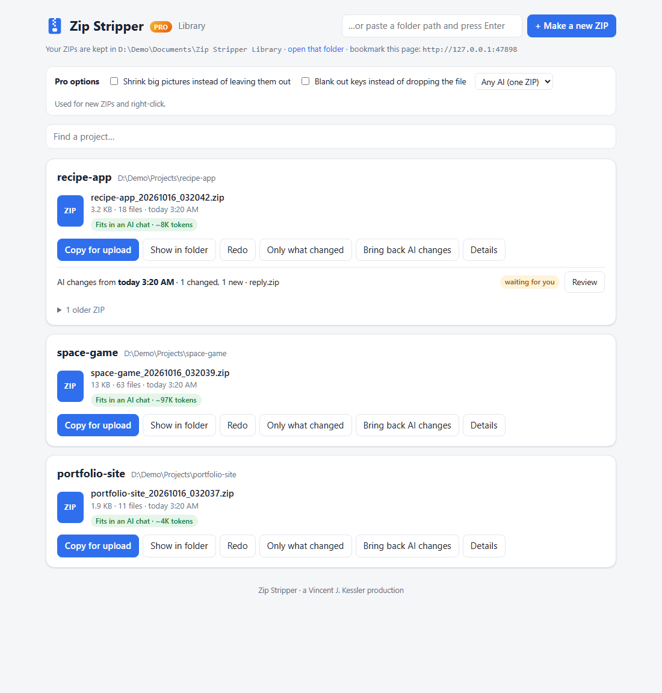
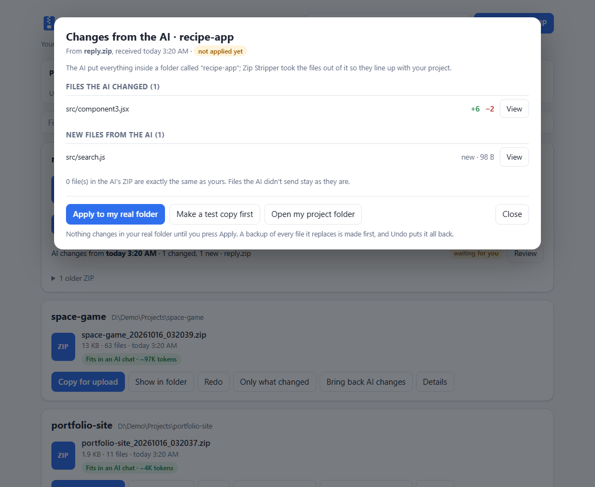

# Zip Stripper

**Right-click a folder → get a clean, safe ZIP your AI can actually use.**

*A Vincent J. Kessler production.* Free and open source (MIT). Windows-first, Python 3.10+, no other installs.



You built something with ChatGPT, Claude or Gemini, and now you need to send the whole project back. The raw folder is huge (`node_modules`, caches, build output), full of screenshots, and possibly full of passwords. Zip Stripper makes a copy, takes all of that out, and zips what's left. **Your real folder is never touched.**

## What it does

- **Keeps your secrets out.** `.env` files, `credentials.json`, `*.pem` / `*.key`, SSH private keys, `.aws` / `.ssh` folders, and any file with an API key inside (Anthropic, OpenAI, GitHub, AWS, Google, Stripe, Slack, Hugging Face, private-key blocks) are left out and listed loudly. The key itself is never printed.
- **Respects your `.gitignore`**, root and nested, so anything you'd never put on GitHub stays home.
- **Strips the junk**: `node_modules`, virtual environments, caches, build output, logs, old ZIPs.
- **Makes it small**: identical files go in once, and big pictures/video/PDFs are left out (each one listed).
- **Tells you if it's still too big** for an AI chat, and which folders to trim.
- **Keeps a library** of every ZIP you made, on a page in your browser (**http://127.0.0.1:47811/**): newest first, with **Copy for upload** (then press Ctrl+V in the chat), Show in folder, Redo and the full receipt.
- **Makes a real ZIP**, not one giant text file, so the AI can unpack it, run it and see your folders.

## Install (Windows)

1. Install [Python 3.10+](https://www.python.org/downloads/) and tick **"Add python.exe to PATH"**.
2. [Download Zip Stripper](https://github.com/vincentjkessler/zip-stripper/releases/latest), unzip it anywhere you like.
3. Double-click **`Install.cmd`**.

That adds **Strip & Zip for AI Upload** to the right-click menu of every folder, starts the Library page with Windows, and opens it. Bookmark the page. `Uninstall.cmd` removes both (your ZIPs stay).

> Windows may show "Windows protected your PC" the first time. Click **More info → Run anyway**. Zip Stripper is open source; you can read every line.

## Use it

- **Right-click any folder → Strip & Zip for AI Upload.** The Library page opens on your new ZIP.
- Press **Copy for upload**, click in the ChatGPT / Claude / Gemini message box, press **Ctrl+V**.
- Or from a terminal: `py -3 zip_stripper.py "C:\path\to\project"`

Every ZIP lives in `Documents\Zip Stripper Library\<project>\<date_time>\`. The ZIP is alone in its folder; the receipt and reports sit in `details\` beside it.

## Zip Stripper Pro

A paid add-on for people who send projects back and forth with an AI every day. **[Get Zip Stripper Pro](https://vincentjkessler.github.io/zip-stripper/#pro)**

| | Free | Pro |
|---|:---:|:---:|
| Clean ZIP, secrets out, `.gitignore`, junk stripped | ✓ | ✓ |
| Library page, Copy for upload, receipts | ✓ | ✓ |
| **Bring back AI changes**: drop the AI's ZIP on the page, see exactly what it changed, test it on a copy, apply it with a backup, undo in one click | | ✓ |
| **Only what changed**: tiny follow-up ZIPs with just the files you changed since last time, plus a change list for the AI | | ✓ |
| **Fit for Claude / ChatGPT / Gemini**: most important files first, split into Part 1, Part 2… if needed | | ✓ |
| **Blank out keys instead of dropping the file**: the AI still sees your code, the key becomes `<REDACTED>` | | ✓ |
| **Shrink pictures instead of dropping them**: smaller copies go in, so the AI can still see your art | | ✓ |



## How it compares

| | Zip Stripper | Text-digest tools (e.g. Repomix, Gitingest) |
|---|---|---|
| Output | Real ZIP with your folders | One big text file |
| Secret check, `.gitignore`, token count | ✓ | ✓ (Repomix) |
| Right-click, no command line | ✓ | – |
| Library of everything you sent | ✓ | – |
| Bring the AI's changes back safely | ✓ Pro | – |
| Only-what-changed follow-ups | ✓ Pro | – |

Text digests are great for pasting a repo into a prompt. Zip Stripper is for handing a project to an AI and getting it back.

## Options

| Switch | What it does |
|---|---|
| `--keep-secrets-file PATH` | Keep one file even though it looks secret (repeatable) |
| `--no-gitignore` | Ignore the project's `.gitignore` files |
| `--keep-media` / `--media-cutoff-kb N` | Keep big pictures / change the 250 KB cutoff |
| `--keep-duplicates` | Keep every copy of identical files |
| `--profile source` | Only source, config, docs and tests |
| `--output FOLDER` | Old layout: ZIP and reports side by side in one folder |
| `--shrink-media`, `--redact-secrets`, `--changes-only`, `--fit-for claude\|chatgpt\|gemini` | Pro |

Per-project rules go in a `.zipstripperignore` file (see [`.zipstripperignore.example`](.zipstripperignore.example)). Settings: `ZIPSTRIPPER_LIBRARY` (library folder), `ZIPSTRIPPER_PORT` (page port).

## Safety

- Your project is never modified: Zip Stripper copies it to a temporary folder and zips the copy.
- The Library page only listens on your own computer (`127.0.0.1`) and refuses requests from other websites.
- The secret check looks for well-known patterns. It can't promise to catch every possible secret, so read the receipt before you share a ZIP.

## Test it

```powershell
py -3 -m pytest -q tests
```

## License

Zip Stripper is MIT licensed, see [LICENSE](LICENSE). Zip Stripper Pro is a separate paid add-on and is not part of this repository.
